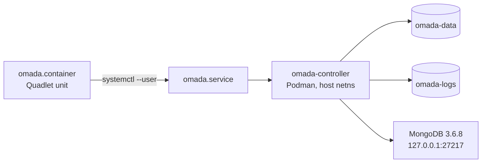

# Deploying the Omada Controller with Podman on Fedora

A rootless-Podman deployment of this image, prepared for a small Fedora Server
host. Everything in this directory is self-contained: one Quadlet unit, one
firewall helper, and this document.

| | |
| :-- | :-- |
| Image | `docker.io/mbentley/omada-controller:5.15.24.19` |
| Runtime | Rootless Podman 5.8.8 (netavark), Fedora Server 43 |
| Supervision | systemd via [Quadlet](https://docs.podman.io/en/latest/markdown/podman-systemd.unit.5.html) — `omada.service` |
| Networking | `Network=host` (required for device discovery/adoption) |
| Persistence | named volumes `omada-data`, `omada-logs` |
| Controller | 5.15.24.19, Java 17.0.15, embedded MongoDB 3.6.8 |
| Web UI | `https://<host>:8043` (self-signed) |



---

## 1. Why this deviates from the repo defaults

### The CPU has no AVX, so v6 is not an option

The target host is an Intel Celeron N3350 (Apollo Lake). It has **no AVX**
(`grep -c avx /proc/cpuinfo` → `0`). v6 images ship MongoDB 8, which requires
AVX and aborts at the pre-flight check:

```
INFO: running hardware prerequisite check for AVX support on x86_64 to ensure your system can run MongoDB 8...
ERROR: your system does not support AVX which is a requirement for the v6 and above container image as it only ships with MongoDB 8
```

The container then crash-loops (`restart counter is at 14`, `status=1/FAILURE`).
This is the scenario described in [Known Issues → AVX](../README.md#your-system-does-not-support-avx-or-armv82-a).

Measured on this host:

| Image | Result |
| :-- | :-- |
| `mongo:4.4` | starts, `Waiting for connections` |
| `mongo:7` | dies: `traps: mongod trap invalid opcode` (SIGILL, missing AVX) |
| `omada-controller:6.3` | crash-loops on the AVX pre-flight check |
| `omada-controller:5.15.24.19` | **runs** — bundles MongoDB 3.6.8 |

Hence the pin. `5.15.24.19` is the last v5 build and its embedded MongoDB 3.6.8
does not require AVX.

> v6-on-this-hardware would require an [external MongoDB](../external_mongodb/)
> — and MongoDB 8 still needs AVX, so that does not help here either. v5.15 is
> the practical ceiling for this machine; the real fix is newer hardware.

Because the image is pinned to v5, the v6-only knobs from the compose files
(`UPGRADE_ES_HTTPS_PORT`, `PORT_DEVICE_MONITOR`) are commented out in the unit.

### The host is small

2 cores / 3.6 GiB RAM. Defaults assume far more, so the unit applies the
[low-resource tuning](../README.md#low-resource-systems) from the main README
plus a cgroup guard rail. See [§7](#7-resource-tuning).

---

## 2. Install

```bash
# on the target host, as the user that will own the container (no root needed)
mkdir -p ~/.config/containers/systemd
cp omada.container ~/.config/containers/systemd/
systemctl --user daemon-reload
systemctl --user start omada.service
```

`podman pull docker.io/mbentley/omada-controller:5.15.24.19` beforehand is
optional; the unit pulls if the image is missing.

Autostart on boot requires lingering for the user (`loginctl enable-linger
$USER`). The unit's `[Install] WantedBy=default.target` is what makes systemd
start it at boot — no `systemctl --user enable` needed (Quadlet generates and
enables the unit at `daemon-reload`; `is-enabled` reports `generated`, which is
normal).

---

## 3. Day-to-day operations

```bash
systemctl --user status omada.service      # state (NRestarts, memory, cgroup)
journalctl --user -u omada.service -f      # controller + mongod logs
systemctl --user restart omada.service     # restart  (~minutes to come back, see §9)
systemctl --user stop omada.service        # graceful stop (60s grace)
podman stats --no-stream omada-controller  # live CPU / memory
```

After changing `~/.config/containers/systemd/omada.container`:

```bash
systemctl --user daemon-reload
systemctl --user restart omada.service
```

### Backups

Named volumes survive container recreation. Two options:

```bash
# 1. preferred: the controller's own web UI (Settings → Maintenance → Backup)
# 2. raw volume export
podman volume export omada-data -o omada-data-$(date +%F).tar
```

Restoring a raw export requires the container to be stopped, then
`podman volume import omada-data omada-data-<date>.tar`.

### Upgrading the controller

Within v5: edit the tag in the unit, `daemon-reload`, `restart`. Data in
`omada-data` is preserved and the entrypoint performs the version checks.

**Do not** point this at a `:6`, `:6.3` or `:latest` tag — it will crash-loop on
this CPU (see §1). A v6 migration requires AVX-capable hardware.

---

## 4. Ports

The container shares the host network namespace, so the controller binds
directly to the host interface:

| Proto | Port(s) | Purpose |
| :-- | :-- | :-- |
| TCP | 8043 | Management portal (HTTPS) |
| TCP | 8088 | Management portal (HTTP, 302 → 8043) |
| TCP | 8843 | Captive portal (HTTPS) |
| TCP | 29811-29814 | Omada device management (v1 & v2) |
| TCP | 29815 | Device info / packet capture transfer (v2) |
| TCP | 29816 | Remote terminal (RTTY) |
| TCP | 9090 | Controller internal HTTP API |
| TCP | 9098 | Controller internal gRPC |
| UDP | 29810 | **Discovery** — controller ↔ Omada devices |
| UDP | 27001 | Discovery by the Omada mobile app |
| UDP | 19810 | Device adoption broadcast |

`29817` (device monitor) and `8044` (ES-series upgrade) are **v6-only** and stay
closed here — expected.

The discovery/adoption listeners come up **a couple of minutes after** the web
UI. In the log that is `OmadacDiscoveryStartUpTask start` followed by
`discovery Port is 29810` / `adopt port v1 is 29812`. Until then only 8043/8088/
8843/27217 are listening — that is not a failure.

---

## 5. Firewall

`Network=host` means the host firewall filters everything. Fedora Server's
default zone (`FedoraServer`) allows only `ssh`, `cockpit` and `dhcpv6-client`,
so inbound access to the controller is **blocked until you open the ports**:

```bash
sudo bash open-firewall.sh
```

The script is idempotent and takes the zone from `firewall-cmd
--get-default-zone` (override with `OMADA_ZONE=<zone>`). It opens 8088, 8043,
8843, 8044, 29811-29817 TCP and 27001, 29810, 19810 UDP, then reloads.

Verify from another machine on the LAN:

```bash
curl -sk -o /dev/null -w '%{http_code}\n' https://<host>:8043/
```

`000` means still blocked (or the controller is not up yet).

---

## 6. Access and first run

1. `https://<host>:8043` — accept the self-signed certificate.
2. Complete the setup wizard (admin account, site/controller name).
3. Devices on the same L2 network are discovered on UDP 29810. If a device is on
   another subnet, or discovery is blocked, point it at the controller by hand:
   see [DEVICE_ADOPTION.md](../DEVICE_ADOPTION.md).

---

## 7. Resource tuning

Applied in the unit (all supported by the image, see
[Optional Environment Variables](../README.md#optional-environment-variables)):

| Setting | Value | Why |
| :-- | :-- | :-- |
| `JAVA_MAX_HEAP_SIZE` | `512m` | image default is `-Xmx1024m` |
| `JAVA_MIN_HEAP_SIZE` | `128m` | image default |
| `MONGOD_EXTRA_ARGS` | `--wiredTigerCacheSizeGB 0.25` | default cache is half of RAM |
| `MemoryHigh` / `MemoryMax` (unit) | `1100M` / `1500M` | if the JVM runs away it gets OOM-killed instead of wedging the host |

**Gotcha:** `MONGOD_EXTRA_ARGS` contains a space, so it *must* be quoted in the
unit. Unquoted, systemd splits it and mongod is invoked as
`mongod --wiredTigerCacheSizeGB` with no value:

```
INFO: MONGOD_EXTRA_ARGS='--wiredTigerCacheSizeGB'; creating mongod wrapper (real binary: /usr/bin/mongod)
ERROR [main] ... Fail to start mongo DB server with exit code 2
```

Correct form: `Environment="MONGOD_EXTRA_ARGS=--wiredTigerCacheSizeGB 0.25"`.

Measured steady state after tuning: **~1.15 GiB RSS, ~4% CPU** at idle.

---

## 8. Verification performed

Commands run against the live host, and what they returned:

```bash
$ systemctl --user is-active omada.service
active

$ podman ps --filter name=omada-controller --format '{{.Image}} {{.Status}}'
docker.io/mbentley/omada-controller:5.15.24.19  Up

$ curl -sk -o /dev/null -w '%{http_code}' https://127.0.0.1:8043/     # 200
$ curl -sk -o /dev/null -w '%{http_code} %{redirect_url}' http://127.0.0.1:8088/   # 302 -> https://.../8043/

$ ss -ltn | grep -E ':(8043|8088|8843|2981[0-9])'     # all present
$ ss -lun | grep -E ':(29810|27001|19810)'            # all present

$ free -h        # 1.9 GiB available with only the controller running
$ cat /proc/loadavg   # 0.09 load once the monitoring stack was disabled
```

* **Autostart verified for real:** the host crashed and rebooted mid-setup (see
  §10) and `omada.service` came back `active` on its own — linger +
  `WantedBy=default.target` work.
* **SELinux:** no AVC denials attributable to the controller
  (`journalctl -b | grep denied | grep -E 'java|mongod'` → empty).
* **Rootless:** `podman info` → `Rootless: true`; the process runs as container
  uid `508` (`PUID`), mapped to a subuid on the host.

---

## 9. Known behaviour on this hardware

### Cold start takes minutes, not seconds

Measured **~10-13 minutes** for a first start. The JVM spends its time scanning
the classpath/JARs (`java.util.zip.ZipFile$Source.getEntryPos`) and C2 JIT
compiling, on 2 cores at 1.1 GHz. A thread dump during startup confirms it is
*progressing*, not deadlocked:

```
"main" #1 ... cpu=89323.85ms elapsed=568.12s runnable
   at java.util.zip.ZipFile$Source.getEntryPos(ZipFile.java:1816)
   at jdk.internal.loader.BuiltinClassLoader.findClassOnClassPathOrNull(...)
"C2 CompilerThread0" ... cpu=31239.54ms runnable
```

Do not restart it "because it looks stuck" — check `podman stats` first: if the
container is burning CPU and `main` is `RUNNABLE`, it is just slow. Subsequent
restarts are faster but still measured in minutes.

If startup speed matters, `_JAVA_OPTIONS="-XX:TieredStopAtLevel=1"` avoids most
C2 compilation (trades peak throughput for faster boot) — not enabled by default.

### Do not co-locate it with a heavy stack on 3.6 GiB

Startup had not completed after 10 minutes while a Prometheus/Grafana stack was
also running (load average ~11 on 2 cores); it finished minutes after those
containers exited, and the box's load dropped from ~10 to ~0.09. On this class of
hardware, give the controller the box or expect a very slow boot.

---

## 10. Troubleshooting

| Symptom | Cause | Fix |
| :-- | :-- | :-- |
| Crash-loop, log says `does not support AVX` | v6 image + MongoDB 8 on a non-AVX CPU | pin a `5.x` tag (§1) |
| `Fail to start mongo DB server with exit code 2`, log shows `MONGOD_EXTRA_ARGS='--wiredTigerCacheSizeGB'` | unquoted value with a space in the unit | quote the whole `Environment=` value (§7) |
| Web UI unreachable from other machines, `curl` returns `000` | firewalld blocks the ports | `sudo bash open-firewall.sh` (§5) |
| Only 8043/8088/8843 listening | discovery/adoption tasks still starting | wait — see §4 |
| Service restarts forever, `NRestarts` climbing | usually the AVX check or a mongod arg error | `journalctl --user -u omada.service -n 50` |
| HTTP 200 locally but 000 from LAN | host firewall (not the controller) | §5 |

### Host incident during this deployment (2026-10-31)

The machine **hard-froze and rebooted** a couple of minutes into the first JVM
start. The next boot reported:

```
systemd-journald: File /var/log/journal/.../system.journal corrupted or uncleanly shut down, renaming and replacing.
chronyd: System clock wrong by 10807.841615 seconds
```

There was **no OOM kill, no thermal event and no MCE** in the previous boot's
kernel log (`journalctl -k -b -1`), and the controller itself recovered by
itself after reboot. Post-crash fallout worth cleaning up — `rsyslogd` was
burning 70%+ CPU replaying a corrupt journal state file, directly competing with
the controller's startup:

```bash
sudo systemctl stop rsyslog
sudo rm -f /var/lib/rsyslog/imjournal.state
sudo systemctl start rsyslog
```

Also check the hardware side (the box lost ~3h of RTC, suggesting power/CMOS
issues): `journalctl -k -b -1 | tail`, PSU, cooling, and the RTC battery.

---

## 11. Uninstall / rollback

```bash
systemctl --user disable --now omada.service
rm ~/.config/containers/systemd/omada.container
systemctl --user daemon-reload
podman volume rm omada-data omada-logs     # DESTROYS controller data
sudo bash open-firewall.sh                 # then remove the ports by hand
```

Rollback of just the tuning or the image tag is a unit edit + restart; the data
volume is untouched.

---

## 12. References

* [Main README](../README.md) — image tags, env vars, persistent data, AVX notes
* [Known Issues](../README.md#known-issues) — including
  [AVX/armv8.2-a](../README.md#your-system-does-not-support-avx-or-armv82-a)
* [DEVICE_ADOPTION.md](../DEVICE_ADOPTION.md) — manual adoption
* [external_mongodb/](../external_mongodb/) — split MongoDB deployment
* [Quadlet / podman-systemd.unit](https://docs.podman.io/en/latest/markdown/podman-systemd.unit.5.html)
* [firewalld](https://firewalld.org/documentation/)
